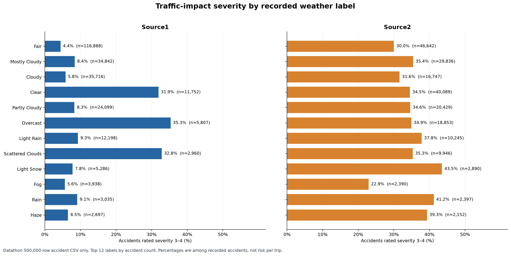

# Weather and traffic-impact severity (CSV only)

This is Kevin's first analysis for the team branch. It uses only the provided `US_Accidents_March23_sampled_500k.csv`; no outside dataset or USDA ZIP labels are used.

## Question

Among recorded accidents, what percentage had traffic-impact severity 3 or 4 under each of the 12 most common weather labels? We show Source1 and Source2 separately because their results differ substantially. Source3 remains in the notebook table.

## Files

- [Notebook](weather-severity-csv-only.ipynb): the calculations, exact counts, percentages, and checks.
- [Chart](../charts/weather_severity_by_source.png): an easy-to-read comparison of Source1 and Source2.
- The accident CSV belongs in `data/` locally. Git ignores that folder, so the large dataset is not uploaded.

## How the calculation works

1. Read the CSV columns `Weather_Condition`, `Severity`, and `Source`.
2. Find the 12 weather labels with the most recorded accidents. These are common labels, not an official definition of extreme weather.
3. Count accidents rated severity 3 or 4 for each label and source.
4. Divide that count by all recorded accidents with the same label and source.

For example, under **Fair** weather, Source1 has **5,182 of 116,888** accidents rated 3 or 4 (**4.4%**). Source2 has **13,993 of 46,642** (**30.0%**). This large source difference is why we should not combine the sources into one weather ranking.

## Limits and next decision

- **11,101** of the 500,000 accident rows have no weather label; severity has no missing values.
- Severity describes **traffic impact**, not injuries.
- This CSV contains accidents, not all trips or miles driven. These percentages do not measure the chance of an accident in each weather condition.
- The chart shows an association in this sample. It does not prove weather caused an accident or its traffic impact.
- The team should decide which weather labels count as “extreme” before making a final extreme-weather claim.

To rerun, open the notebook in VS Code with Python, pandas, Matplotlib, and Jupyter installed, then run its cells from top to bottom.
